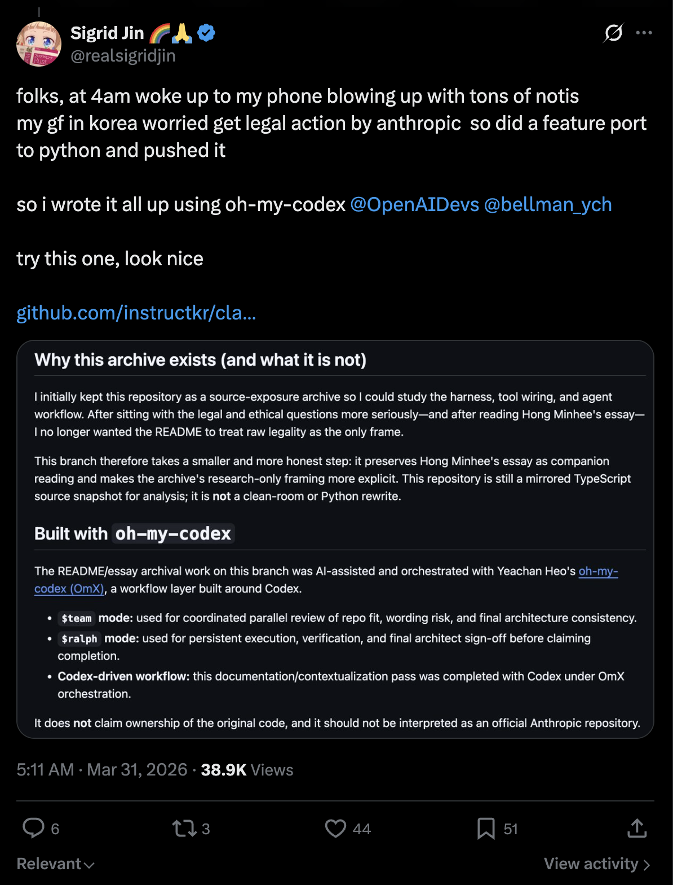
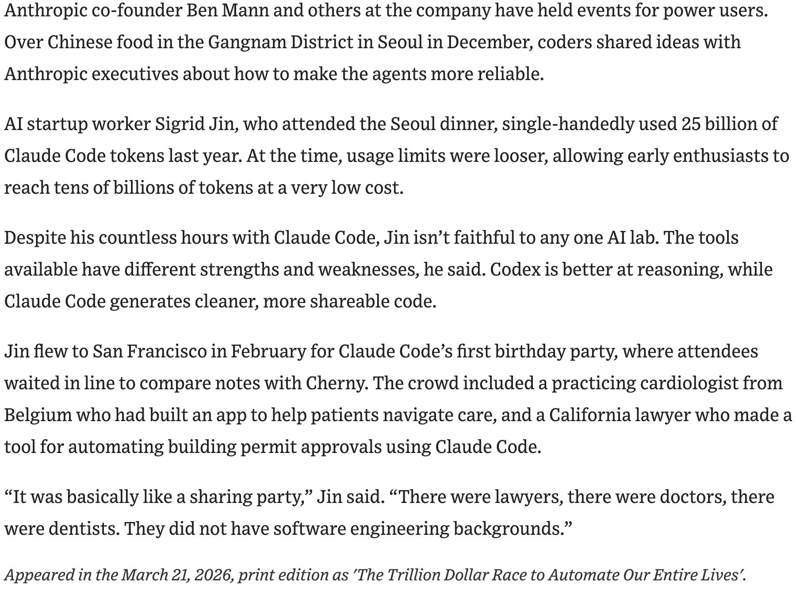
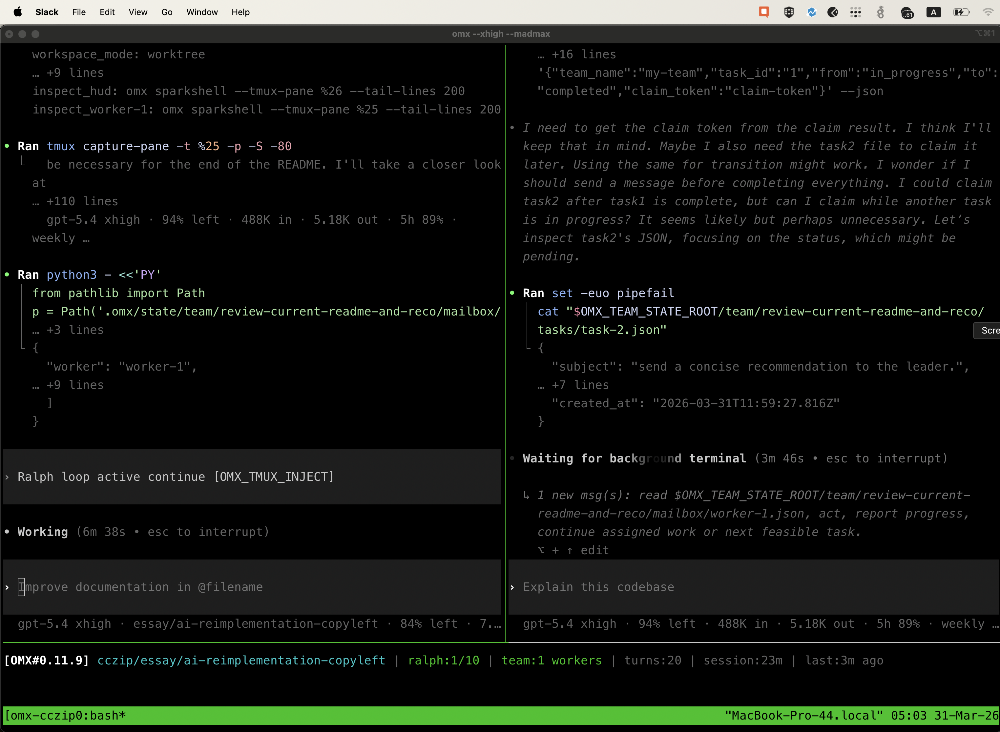
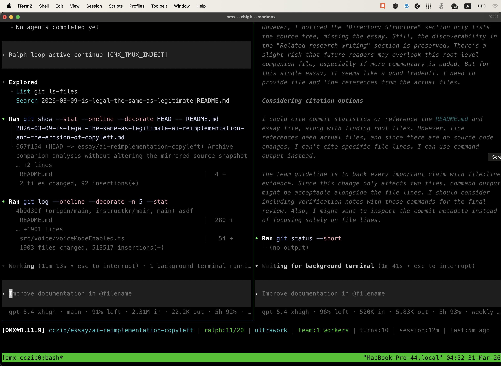
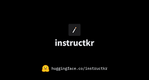

# Réécriture du Projet Claw Code

<p align="center">
  <strong>Le dépôt le plus rapide de l'histoire à dépasser 50 000 étoiles, atteignant ce jalon en seulement 2 heures après sa publication</strong>
</p>

<p align="center">
  <a href="https://star-history.com/#instructkr/claw-code&Date">
    <picture>
      <source media="(prefers-color-scheme: dark)" srcset="https://api.star-history.com/svg?repos=instructkr/claw-code&type=Date&theme=dark" />
      <source media="(prefers-color-scheme: light)" srcset="https://api.star-history.com/svg?repos=instructkr/claw-code&type=Date" />
      
    </picture>
  </a>
</p>

<p align="center">
  
</p>

<p align="center">
  <strong>De meilleurs outils de harness, sans se contenter de stocker l'archive du code Claw Code divulgué</strong>
</p>

<p align="center">
  <a href="https://github.com/sponsors/instructkr"></a>
</p>

> [!IMPORTANT]
> **Le portage Rust est en cours** sur la branche [`dev/rust`](https://github.com/instructkr/claw-code/tree/dev/rust) et devrait être fusionné dans main aujourd'hui. L'implémentation Rust vise à fournir un runtime de harness plus rapide et sûr en mémoire. Restez à l'écoute — ce sera la version définitive du projet.

> Si ce travail vous est utile, envisagez de [sponsoriser @instructkr sur GitHub](https://github.com/sponsors/instructkr) pour soutenir la recherche continue en ingénierie de harness open-source.

---

## Portage Rust

L'espace de travail Rust sous `rust/` est le portage actuel du projet vers un langage système.

Il comprend actuellement :

- `crates/api-client` — client API avec abstraction de fournisseur, OAuth et prise en charge du streaming
- `crates/runtime` — état de session, compactage, orchestration MCP, construction de prompts
- `crates/tools` — définitions de manifestes d'outils et framework d'exécution
- `crates/commands` — commandes slash, découverte de skills et inspection de configuration
- `crates/plugins` — modèle de plugins, pipeline de hooks et plugins intégrés
- `crates/compat-harness` — couche de compatibilité pour l'intégration avec l'éditeur amont
- `crates/claw-cli` — REPL interactif, rendu markdown et flux d'amorçage/initialisation de projet

Lancer la compilation Rust :

```bash
cd rust
cargo build --release
```

## Contexte

À 4 heures du matin le 31 mars 2026, je me suis réveillé avec mon téléphone qui explosait de notifications. Le code source de Claw Code avait été exposé, et toute la communauté de développeurs était en effervescence. Ma copine en Corée s'inquiétait sincèrement que je puisse faire face à des poursuites de la part des auteurs originaux juste pour avoir le code sur ma machine — alors j'ai fait ce que tout ingénieur ferait sous la pression : je me suis assis, j'ai porté les fonctionnalités principales vers Python à partir de zéro, et je l'ai publié avant le lever du soleil.

L'ensemble a été orchestré de bout en bout avec [oh-my-codex (OmX)](https://github.com/Yeachan-Heo/oh-my-codex) par [@bellman_ych](https://x.com/bellman_ych) — une couche de workflow construite par-dessus Codex d'OpenAI ([@OpenAIDevs](https://x.com/OpenAIDevs)). J'ai utilisé le mode `$team` pour la revue de code en parallèle et le mode `$ralph` pour les boucles d'exécution persistantes avec vérification au niveau architecte. Toute la session de portage — depuis la lecture de la structure du harness original jusqu'à la production d'un arbre Python fonctionnel avec tests — a été pilotée via l'orchestration OmX.

Le résultat est une réécriture Python en chambre blanche qui capture les motifs architecturaux du harness d'agent Claw Code sans copier la moindre source propriétaire. Je collabore désormais activement avec [@bellman_ych](https://x.com/bellman_ych) — le créateur d'OmX lui-même — pour pousser cela plus loin. Les fondations Python de base sont déjà en place et fonctionnelles, mais nous ne faisons que commencer. **Restez à l'écoute — une version bien plus capable arrive.**

Le portage Rust a été développé avec à la fois [oh-my-codex (OmX)](https://github.com/Yeachan-Heo/oh-my-codex) et [oh-my-opencode (OmO)](https://github.com/code-yeongyu/oh-my-openagent) : OmX a piloté l'échafaudage, l'orchestration et la direction architecturale, tandis qu'OmO a été utilisé pour accélérer l'implémentation ultérieure et soutenir la vérification.

https://github.com/instructkr/claw-code



## Les Créateurs Mis en Avant par le Wall Street Journal pour les Fans Acharnés de Claw Code

Je m'intéresse profondément à l'**ingénierie de harness** — étudiant comment les systèmes d'agents câblent les outils, orchestrent les tâches et gèrent le contexte d'exécution. Ce n'est pas une chose soudaine. Le Wall Street Journal a mis en avant mon travail plus tôt ce mois-ci, documentant comment j'ai été l'un des utilisateurs avancés les plus actifs à explorer ces systèmes :

> Sigrid Jin, salarié d'une startup d'IA, qui a assisté au dîner de Séoul, a utilisé à lui seul 25 milliards de tokens Claw Code l'année dernière. À l'époque, les limites d'utilisation étaient plus souples, permettant aux premiers passionnés d'atteindre des dizaines de milliards de tokens à très faible coût.
>
> Malgré ses innombrables heures passées avec Claw Code, Jin n'est fidèle à aucun laboratoire d'IA particulier. Les outils disponibles ont chacun leurs forces et leurs faiblesses, dit-il. Codex est meilleur en raisonnement, tandis que Claw Code génère du code plus propre et plus partageable.
>
> Jin s'est envolé pour San Francisco en février pour la fête du premier anniversaire de Claw Code, où les participants faisaient la queue pour comparer leurs notes avec Cherny. La foule comprenait un cardiologue en exercice de Belgique qui avait construit une application pour aider les patients à naviguer dans les soins, et un avocat californien qui avait conçu un outil pour automatiser les approbations de permis de construire en utilisant Claw Code.
>
> « C'était essentiellement comme une fête de partage », a déclaré Jin. « Il y avait des avocats, il y avait des médecins, il y avait des dentistes. Ils n'avaient pas de formation en génie logiciel. »
>
> — *The Wall Street Journal*, 21 mars 2026, [*« The Trillion Dollar Race to Automate Our Entire Lives »*](https://lnkd.in/gs9td3qd)



---

## État du Portage

L'arbre source principal est désormais Python-first.

- `src/` contient l'espace de travail de portage Python actif
- `tests/` vérifie l'espace de travail Python actuel
- l'instantané exposé ne fait plus partie de l'état suivi du dépôt

L'espace de travail Python actuel n'est pas encore un remplacement complet et un-à-un du système original, mais la surface d'implémentation principale est désormais Python.

## Pourquoi cette réécriture existe

À l'origine, j'ai étudié la base de code exposée pour comprendre son harness, son câblage d'outils et son flux de travail d'agent. Après avoir passé plus de temps sur les questions juridiques et éthiques — et après avoir lu l'essai lié ci-dessous — je ne voulais pas que l'instantané exposé reste lui-même l'arbre source principal suivi.

Ce dépôt se concentre désormais sur le travail de portage Python.

## Organisation du Dépôt

```text
.
├── src/                                # Espace de travail de portage Python
│   ├── __init__.py
│   ├── commands.py
│   ├── main.py
│   ├── models.py
│   ├── port_manifest.py
│   ├── query_engine.py
│   ├── task.py
│   └── tools.py
├── rust/                               # Portage Rust (CLI claw)
│   ├── crates/api/                     # Client API + streaming
│   ├── crates/runtime/                 # Session, outils, MCP, config
│   ├── crates/claw-cli/               # Binaire CLI interactif
│   ├── crates/plugins/                 # Système de plugins
│   ├── crates/commands/                # Commandes slash
│   ├── crates/server/                  # Serveur HTTP/SSE (axum)
│   ├── crates/lsp/                    # Intégration client LSP
│   └── crates/tools/                   # Spécifications d'outils
├── tests/                              # Vérification Python
├── assets/omx/                         # Captures d'écran du workflow OmX
├── 2026-03-09-is-legal-the-same-as-legitimate-ai-reimplementation-and-the-erosion-of-copyleft.md
└── README.md
```

## Vue d'ensemble de l'espace de travail Python

Le nouvel arbre Python `src/` fournit actuellement :

- **`port_manifest.py`** — résume la structure actuelle de l'espace de travail Python
- **`models.py`** — dataclasses pour les sous-systèmes, modules et l'état du backlog
- **`commands.py`** — métadonnées de portage des commandes côté Python
- **`tools.py`** — métadonnées de portage des outils côté Python
- **`query_engine.py`** — rend un résumé du portage Python à partir de l'espace de travail actif
- **`main.py`** — un point d'entrée CLI pour la sortie de manifeste et de résumé

## Démarrage rapide

Afficher le résumé du portage Python :

```bash
python3 -m src.main summary
```

Afficher le manifeste actuel de l'espace de travail Python :

```bash
python3 -m src.main manifest
```

Lister les modules Python actuels :

```bash
python3 -m src.main subsystems --limit 16
```

Lancer la vérification :

```bash
python3 -m unittest discover -s tests -v
```

Lancer l'audit de parité par rapport à l'archive locale ignorée (lorsqu'elle est présente) :

```bash
python3 -m src.main parity-audit
```

Inspecter les inventaires miroirs de commandes/outils :

```bash
python3 -m src.main commands --limit 10
python3 -m src.main tools --limit 10
```

## Point de contrôle de parité actuel

Le portage reflète maintenant la surface des fichiers d'entrée racine archivés, les noms des sous-systèmes de premier niveau et les inventaires de commandes/outils beaucoup plus fidèlement qu'auparavant. Toutefois, il n'est **pas encore** un remplacement à l'équivalence d'exécution complète du système TypeScript original ; l'arbre Python contient encore moins de tranches exécutables au runtime que la source archivée.

## Construit avec `oh-my-codex` et `oh-my-opencode`

Le portage, le durcissement en chambre blanche et le workflow de vérification de ce dépôt ont été assistés par IA grâce à la pile d'outils de Yeachan Heo, avec **oh-my-codex (OmX)** comme couche principale d'échafaudage et d'orchestration.

- [**oh-my-codex (OmX)**](https://github.com/Yeachan-Heo/oh-my-codex) — échafaudage, orchestration, direction architecturale et workflow principal de portage
- [**oh-my-opencode (OmO)**](https://github.com/code-yeongyu/oh-my-openagent) — accélération de l'implémentation, nettoyage et soutien à la vérification

Modèles de workflow clés utilisés pendant le portage :

- **Mode `$team` :** revue parallèle coordonnée et retours architecturaux
- **Mode `$ralph` :** exécution persistante, vérification et discipline de finalisation
- **Passes en chambre blanche :** nettoyage de nommage/identité visuelle, AQ et validation de release sur l'espace de travail Rust
- **Validation manuelle et en direct :** build, tests, AQ manuelle et vérification de chemin d'API réel avant publication

### Captures d'écran du workflow OmX



*Vue d'orchestration Ralph/team pendant que le README et le contexte de l'essai étaient revus dans des panneaux de terminal.*



*Flux de revue et de vérification en panneaux divisés lors de la passe finale de formulation du README.*

## Communauté

<p align="center">
  <a href="https://instruct.kr/"></a>
</p>

Rejoignez le [**Discord instructkr**](https://instruct.kr/) — la meilleure communauté coréenne autour des modèles de langage. Venez discuter des LLM, de l'ingénierie de harness, des workflows d'agents et de tout ce qui se trouve entre les deux.

[](https://instruct.kr/)

## Historique des étoiles

Voir le graphique en haut de ce README.

## Avertissement de propriété / affiliation

- Ce dépôt **ne revendique pas** la propriété du matériel source original de Claw Code.
- Ce dépôt **n'est pas affilié, approuvé ni maintenu par les auteurs originaux**.
